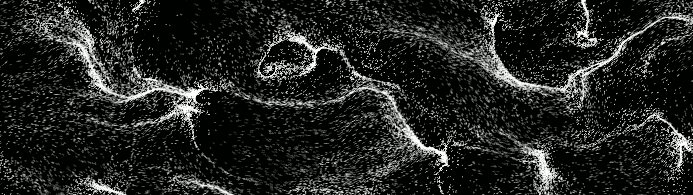
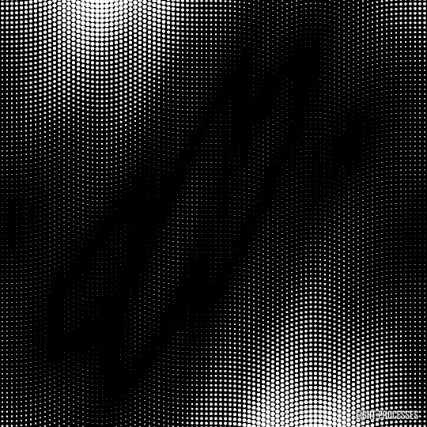

 

<h2 align="center">👤 Sobre mí</h2>

<table>
<tr>
<td valign="middle">

¡Hola! Soy **Juan Pedro Suñer**, estudiante de Ingeniería en Sistemas de La Plata, Argentina. Me gusta aprender tecnologías nuevas y llevarlas a proyectos reales: hoy trabajo con **Next.js**, **TypeScript** y bases de datos, con foco en backend y en la intersección entre datos e IA.

**🏛️ Cursando Sistemas en la Universidad Nacional de La Plata (UNLP)** 
**🐍 Colaborador del Seminario de Lenguajes (Python) en la UNLP** 
**🧪 Participante de Oracle GenO Argentina** 
**🔭 Construyendo AetherScope, un navegador del espacio profundo**

</td>
<td align="center" width="300">

</td>
</tr>
</table>

<h2 align="center">⚙️ Tecnologías</h2>

 

 

 

<h2 align="center">🚀 Proyectos</h2>

<table>
<tr>
<td valign="top" width="50%">

### 🔭 [AetherScope](https://aether-scope-two.vercel.app/)

Visualizador y analizador del espacio profundo con datos reales de **JWST, Hubble, Chandra y Gaia**, sobre un lienzo celeste interactivo con **Aladin Lite**. Incluye análisis de sectores y una bitácora de misión.

[🌐 Ver demo](https://aether-scope-two.vercel.app/)

</td>
<td valign="top" width="50%">

### ☀️ FlareField

Alertas de clima espacial para trabajadores rurales de Argentina, con datos de **NASA DONKI** y **NOAA** sobre un mapa interactivo y una interfaz oscura tipo *glass*.

</td>
</tr>
</table>

<h2 align="center">📈 Estadísticas</h2>

  

